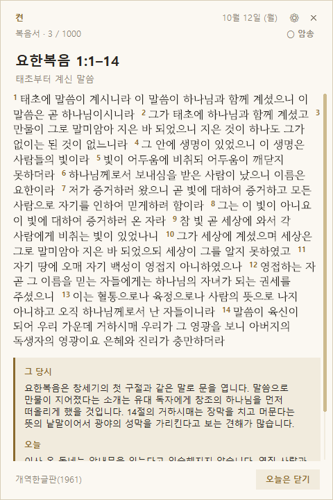
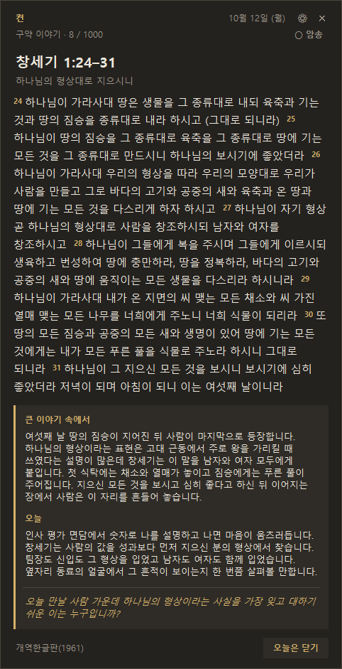
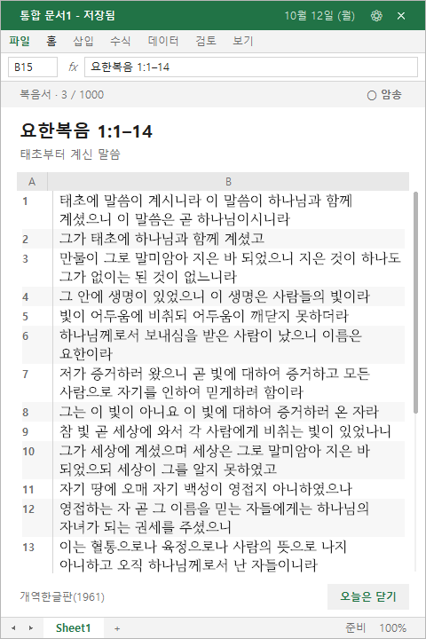

# 켠 (kyeon)

> **화면 한켠, 마음 한가운데**

<p align="center">
  <picture>
    <source media="(max-width: 600px)" srcset="docs/overview-mobile.svg">
    
  </picture>
</p>

<p align="center">
  <a href="docs/overview.svg">크게 보기</a> ·
  <a href="docs/overview-mobile.svg">모바일 그림</a> ·
  <a href="CHANGELOG.md">변경 기록</a>
</p>

**켠**은 화면 한켠에 조용히 앉아 있다가, 하루에 한 번 말씀 한 덩이를 보여 주는 Windows 위젯이에요.
본문은 개역한글이고, 그 밑에 이 말씀이 그 시대엔 무슨 뜻이었는지, 오늘 내 하루엔 어떻게 닿는지를 짧게 붙였어요.

이름엔 뜻이 두 가지 있어요. 화면의 **한켠**에 자리 잡는다는 뜻, 그리고 컴퓨터를 **켤** 때마다 불이 하나 들어온다는 뜻이에요.
성경을 통으로 읽기 어려운 요즘, 하루에 한 덩이만 마음 한가운데에 놓아 보자는 데서 시작했어요.

## 설치

Windows 10·11이면 돼요. **Python 같은 걸 먼저 깔 필요는 없어요.**

<p align="center">
  <a href="https://github.com/kcc920926-droid/kyeon/releases/latest/download/kyeon.exe"><b>⬇&nbsp;&nbsp;kyeon.exe 내려받기</b></a>
</p>

1. 위 링크에서 `kyeon.exe`를 내려받아요.
2. 받은 파일을 두 번 눌러요.
3. `켠을 이 PC에 설치할까요?` 창이 뜨면 `예`를 눌러요. 설치가 끝나면 바로 위젯이 떠요.

관리자 권한은 필요 없고, 내 사용자 폴더(`%LOCALAPPDATA%\Programs\Kyeon`)에만 깔려요. 이제 컴퓨터를 켤 때마다 하루에 한 번 알아서 떠요.

> **다른 분께 알려 드릴 땐 이 페이지 주소만 보내면 돼요.** 받는 분은 위 링크로 내려받아서 두 번 누르기만 하면 끝이에요.

### 경고 창이 뜨면

`kyeon.exe`에는 아직 게시자 서명이 없어서, 처음 내려받거나 실행할 때 경고가 뜰 수 있어요. 화면은 브라우저와 Windows 버전마다 조금씩 달라요.

- 브라우저가 '일반적으로 다운로드되지 않는 파일'이라고 하면 `유지`(또는 `그래도 유지`)를 눌러요.
- `Windows에서 PC를 보호했습니다`가 뜨면 `추가 정보`를 누르고, 그다음에 나오는 `실행`을 눌러요.
- 회사에서 관리하는 PC는 서명 없는 프로그램을 막아 두기도 해요. 그럴 땐 보안 담당자에게 물어보세요.

<details>
<summary>경고 없이 깔고 싶다면 (PowerShell 한 줄)</summary>

PowerShell을 열어 아래 한 줄을 붙여 넣어요. 인터넷에서 받은 파일에 붙는 표시(웹 표시)가 없어서 위의 경고 창을 안 거치는 경우가 많아요. 하는 일은 `kyeon.exe`를 받아 SHA-256을 확인한 다음 위와 같은 설치를 묻지 않고 대신 해 주는 게 전부예요.

```powershell
irm https://raw.githubusercontent.com/kcc920926-droid/kyeon/main/install.ps1 | iex
```

스크립트가 짧으니, 실행하기 전에 [install.ps1](install.ps1)을 읽어 봐도 좋아요.

</details>

<details>
<summary>Python으로 직접 돌리고 싶다면 (개발하는 분께)</summary>

Python 3.8 이상(tkinter 포함)이 있으면 exe 없이 소스로 돌릴 수 있어요.

1. 저장소를 내려받아(`Code > Download ZIP`) 원하는 폴더에 풀어요.
2. `install.bat`을 실행해요. 특정 Python으로 돌리려면 `install.bat C:\Python313\python.exe`처럼 경로를 붙여요.
3. 폴더나 Python을 옮겼다면 `install.bat`을 다시 실행해요. 지우려면 `uninstall.bat`을 실행하면 돼요.

</details>

### 다시 열기, 지우기

- **다시 열기:** `오늘은 닫기`를 눌렀는데 다시 보고 싶으면, 시작 메뉴에서 `켠`을 눌러요.
- **지우기:** Windows `설정 > 앱`(Windows 11은 `설치된 앱`, Windows 10은 `앱 및 기능`)에서 `켠 (kyeon)`을 지워요. 자동 실행 등록과 설치 폴더가 함께 사라지고, 읽던 기록(몇 일차인지)도 지울지 물어봐요. 기록을 남겨 두면 다시 깔았을 때 이어서 읽어요.

## 이런 위젯이에요

- **조용해요.** 평소엔 보이지 않다가 로그온할 때와 매일 자정에 오른쪽 아래에 떠요. 읽고 `오늘은 닫기`를 누르면 그날은 다시 안 떠요.
- **1000일치예요.** 시편 225일, 복음서 225일, 그 밖의 성경 550일로 66권을 모두 지나가요. 시편과 복음서가 번갈아 나와요. 그 사이에 다른 책이 끼어들고요. 복음서는 예수님의 생애 순서대로 읽고 다른 복음서에 같은 사건이 있으면 병행 본문을 표시해요.
- **해설은 그 시대의 뜻에서 출발해요.** 풍습, 지리, 제도, 낱말이 쓰이던 모습을 먼저 짚고 오늘의 장면으로 이어 가요. 기도문이나 질문은 붙이지 않고 해설에서 끝나요.
- **늘 같은 모양으로 떠요.** 창은 세로:가로가 3:2예요. 본문이 길면 오른쪽 스크롤바로 넘겨 읽어요. 위아래 줄은 그대로 붙어 있어요.
- **외우기 좋아요.** 암송 스위치를 켜면 낱말이 띠로 가려져요. 띠를 누르면 다시 보이고요. 얼마나 가릴지는 3단계로 골라요.
- **일하면서도 곁에 둘 수 있어요.** 엑셀 스타일로 바꾸면 위젯이 스프레드시트처럼 보여요. 구절은 행으로, 번호는 A열에 놓여요.
- **새 버전은 알아서 챙겨요.** 로그온할 때 한 번 확인하고, 허락하면 따로 내려받거나 압축을 풀 필요 없이 알아서 바꿔 끼워요.
- **가벼워요.** 관리자 권한도, 다른 프로그램 설치도 필요 없어요.

<p align="center">
  
  
  
</p>

## 쓰는 법

- 위젯 윗부분을 끌어서 위치를 옮겨요. 본문이 길면 마우스 휠이나 오른쪽 스크롤바로 넘겨요. Windows의 라이트/다크 설정을 따라가요.
- 시작한 날이 1일차예요. 1000일을 다 읽으면 처음부터 다시 돌아요. 처음부터 하고 싶으면 설정 창의 `읽기`에서 `처음부터 다시`를 눌러요.

### 설정 창

위젯 맨 위 줄의 톱니(⚙)를 누르면 설정 창이 열려요. 엑셀 스타일에서는 왼쪽 위 `파일` 메뉴가 같은 창을 열어요. 바꾼 값은 바로 적용되고 저장돼요.

| 항목 | 고를 수 있는 값 |
|---|---|
| 스타일 | 기본, 엑셀(업무용) |
| 테마 | 자동(Windows 설정을 따라가요), 라이트, 다크. 엑셀 스타일은 밝은 화면으로 고정 |
| 글자 크기 | 작게, 보통, 크게 (위젯 크기도 같은 비율로 바뀌어요) |
| 표시 위치 | 왼쪽 위, 오른쪽 위, 왼쪽 아래, 오른쪽 아래 |
| 항상 위에 | 켬, 끔 |
| 암송 모드 | 켬, 끔, 가릴 단계 1·2·3 |
| 읽기 | 일차를 골라 이동, 처음부터 다시 |
| 시작 | 로그온할 때 자동 실행 켬, 끔 |
| 업데이트 | 로그온할 때 새 버전 확인 켬, 끔. `지금 확인` 버튼 |

화면이 낮아서 3:2 창이 안 들어가면, 같은 비율로 폭을 줄여 맞춰요(기본 폭의 80%까지). 그래도 본문 칸이 너무 좁으면 글자를 한 단계 줄여요.

### 엑셀 스타일

초록색 제목 줄, 메뉴 줄, 수식 입력줄, 열 머리글(A, B), 줄무늬 행, 시트 탭까지 갖춘 화면이에요. 구절 번호는 A열, 본문은 B열에 놓이고 해설은 아래 칸에 나와요. 설정 창에서 `엑셀`을 고르면 돼요. 메뉴 줄은 모양일 뿐이고, `파일`만 설정 창을 열어요.

<p align="center">
  
</p>

### 암송 모드

위젯 오른쪽 위의 `○ 암송`을 누르면 켜지고, 옆에 1·2·3 단계가 나타나요. 켜고 끈 상태와 단계는 기억해요.

| 단계 | 가려지는 것 |
|---|---|
| 1 | 구절마다 그 구절을 대표하는 핵심 단어 1~3개 (태초, 가라지, 사랑처럼) |
| 2 | 1단계에 더해, 뜻이 중요한 명사와 형용사. 성경에 흔하게 나오는 말(하나님, 사람 같은)은 이 단계에서 따로 가리지 않아요 |
| 3 | 2단계에 더해, 뜻이 있는 말을 모두(명사, 동사, 형용사, 부사 등). 조사와 어미는 어느 단계에서도 보여요 |

가려진 곳은 글자 수만큼 띠로 보여요. 띠를 누르면 그 낱말이 보이고, 오른쪽 `다시 가리기`를 누르면 처음 상태로 돌아가요. 위젯이 다시 뜨면 늘 처음처럼 가려져 있어요.

어떤 말을 가릴지는 사람이 하나하나 고른 게 아니라 계산한 결과예요. 성경 전체에서 얼마나 드물게 나오는지, 그날 제목에 들어 있는지, 본문 안에서 되풀이되는지를 점수로 매겨 핵심 단어를 골랐어요. 2단계의 명사·형용사도 비슷한 방식으로 골랐어요. 낱말을 나누는 일은 한국어 형태소 분석기 [Kiwi](https://github.com/bab2min/Kiwi)(kiwipiepy)가 맡았어요. 결과는 `data/plan.json`의 `lv`에 담았어요. 옛 문체 때문에 어색하게 나뉘는 곳이 가끔 있어요.

## 새 버전은 어떻게 받나요

새 버전이 나오면 위젯 아래쪽에 안내 줄이 떠요. 켠이 스스로 인터넷을 쓰는 건, PC를 켜고 로그온한 직후에 새 버전이 있는지 한 번 확인할 때뿐이에요.

1. **확인해요.** 로그온하고 몇 초 뒤, GitHub에 있는 `latest.json` 파일 하나만 읽어요. 요청에는 프로그램 이름과 버전(`kyeon/0.2.0`)만 담겨요. IP 주소는 다른 웹 요청처럼 GitHub에 보여요.
2. **물어봐요.** 안내 줄의 `업데이트`를 누르기 전에는 아무것도 바꾸지 않아요. `나중에`를 누르면 더 새 버전이 나올 때까지 다시 안내하지 않아요.
3. **바꿔 끼워요.** 달라진 파일만 내려받아서 크기와 SHA-256을 확인하고, 프로그램 문법과 계획표 모양까지 살펴요. 하나라도 어긋나면 아무것도 바꾸지 않아요. 문제가 없으면 파일을 바꾸고 스스로 다시 떠요.
4. **되돌릴 수 있어요.** 바꾸기 전 파일은 `%LOCALAPPDATA%\Kyeon\backup`에 최근 3개 버전까지 남겨 둬요. 도중에 실패하면 알아서 되돌리고, 나중에 `--rollback`으로 직전 버전으로 돌아갈 수도 있어요.

받는 파일은 이름이 정해져 있어요(`*.py`, `*.bat`, `*.md`, `*.txt`, `data/*.json`, `fonts/*`). 그 밖의 경로는 받지 않아요. 새 버전 확인이 싫다면 설정 창의 `업데이트`에서 `끔`을 골라요.

`kyeon.exe` 자체는 Python 실행 환경만 담은 껍데기라서 업데이트로 바뀌지 않아요. 바뀌는 건 프로그램 본체(`kyeon.py`)와 자료예요. 새 버전이 이 껍데기에 없는 기능을 필요로 하면, 바꾸지 않고 "새로 내려받아 설치해 달라"고 알려 줘요.

`data/plan.json`을 직접 고쳐 쓰고 있다면, 새 버전에 계획표가 들어 있을 때 그 파일이 덮어써져요. 고친 파일은 위의 백업 폴더에서 찾을 수 있어요.

배포하는 순서와, 저장소를 관리하는 사람이 곧 코드를 실행시킬 수 있는 사람이라는 점(믿고 맡기는 범위)은 [docs/RELEASING.md](docs/RELEASING.md)에 적어 뒀어요.

### 명령줄

설치 폴더(`%LOCALAPPDATA%\Programs\Kyeon`)의 `kyeon.exe`에 옵션을 붙여서 터미널에서 실행해요. Python으로 돌린다면 `python kyeon.py`를 쓰면 돼요.

```
kyeon.exe --status       등록과 진행 상태 보기
kyeon.exe --check        데이터를 점검하고 오늘의 말씀을 콘솔에 보여 주기
kyeon.exe --day 100      100일차 미리보기 (진행 상태는 그대로)
kyeon.exe --day 100 --recite 2   100일차를 암송 모드 2단계로 미리보기
kyeon.exe --day 100 --skin excel 100일차를 엑셀 스타일로 미리보기
kyeon.exe --skin excel   화면 스타일 저장 (default 또는 excel)
kyeon.exe --reset        1일차부터 다시 시작
kyeon.exe --settings     설정 창 바로 열기 (떠 있는 위젯이 있으면 그 위젯에서 열려요)
kyeon.exe --quit         떠 있는 위젯 끄기
kyeon.exe --update-check 새 버전이 있는지만 확인
kyeon.exe --update       새 버전으로 업데이트 (--yes 를 붙이면 묻지 않아요)
kyeon.exe --rollback     직전 업데이트 전 파일로 되돌리기
kyeon.exe --version
```

`--update-url`을 붙이면 GitHub 대신 다른 곳(https 주소나 폴더)의 `latest.json`을 볼 수도 있어요.

## 읽기 계획

| 구분 | 일수 | 내용 |
|---|---|---|
| 시편 | 225 | 시편 150편을 의미 단위로 나눔 |
| 복음서 | 225 | 예수님의 생애 순서, 병행 본문 표시 |
| 구약 이야기 | 242 | 창세기부터 에스더까지 |
| 지혜서·선지서 | 168 | 욥기부터 말라기까지 |
| 신약 | 140 | 사도행전, 서신서, 요한계시록 |

하루치는 뜻이 끊기지 않는 덩어리예요. 짧으면 시 한 편, 길면 한 장면이나 한 단락이에요.

## 해설은 어떻게 쓰여 있나요

해설은 **기도문도 질문도 없이 해설에서 끝나요.** 본문 성격에 맞춰 아래 6가지 형식이 돌아가며 나와요.

| 형식 | 흐름 |
|---|---|
| 그때·오늘 | 그 당시의 배경 → 오늘 |
| 흔한 오해 바로잡기 | 흔한 읽기 → 당시의 뜻 → 오늘 |
| 한 단어 풀이 | 본문 속 낱말 하나가 당시에 뜻하던 것 → 오늘 |
| 그 자리에 서 보기 | 그 자리에 있던 사람의 눈으로 본 장면 → 오늘 |
| 배경만 | 그 당시의 배경 한 단락 |
| 큰 이야기 속 위치 | 성경 전체 줄거리에서 이 본문이 놓인 자리 → 오늘 |

해설은 **AI가 본문을 보고 썼어요. 사람이 한 줄씩 검토하지는 않았어요.** 역사와 언어는 널리 받아들여진 지식만 썼고, 학설이 갈리는 곳은 단정하지 않으려고 했어요. 쓴 쪽에서 사실이 불확실하다고 표시한 해설은 성경 본문과 웹 자료로 한 번 더 확인해서 틀린 설명을 고치거나 단정을 낮췄어요. 다만 이 확인도 AI가 한 거라 틀린 곳이 남아 있을 수 있어요. 신학적으로 민감한 부분은 직접 확인해 주세요. 고치고 싶다면 `data/plan.json`의 `blocks` 값을 바꾸면 바로 반영돼요. 작성 규칙은 [docs/STYLE.md](docs/STYLE.md)에 정리해 뒀어요.

글투는 [Bamti](https://github.com/kcc920926-droid/bamti)가 옮겨 쓴 [im-not-ai](https://github.com/epoko77-ai/im-not-ai)의 한국어 문체 규칙으로 점검했어요. 연결어미 뒤 쉼표, 같은 끝맺음이 이어지는 문장, 부풀린 표현, 뻔한 비유처럼 AI 티가 나는 말투를 걸러 냈고, 문장 시작이 한쪽으로 쏠리지 않게 전체 분포도 살폈어요. 영어를 옮긴 듯한 번역투도 따로 걸러 냈어요. `~를 빌려 씁니다`, `A를 B로 봅니다`, `~로 알려져 있습니다`, 글이 주어가 되어 "본문은 ~를 알려 줍니다" 하는 문장이 대표적이에요. 같은 규칙을 `tools/tlint.py`로 언제든 다시 돌려 볼 수 있어요.

## 본문 출처

- 본문은 위키문헌 [개역한글판](https://ko.wikisource.org/wiki/개역한글판)에서 가져왔어요. 위키문헌은 이 판을 저작권이 끝난 것(2012년)으로 분류하지만, 대한성서공회가 직접 확인해 준 건 아니에요. 널리 퍼뜨리기 전에 확인해 주세요.
- 가져온 판본에서 이런 걸 손봤어요.
  - 위키문헌 판엔 `세례`를 `침례`로 바꿔 놓은 곳이 많아서, 이 계획에 들어간 절은 대한성서공회 개역한글 표기인 `세례`로 되돌렸어요. 되돌린 절 수는 `data/plan.json`의 `source`에 적혀 있어요.
  - 사본에 없는 절 표시(`[없음]`)는 화면에서 뺐고, 짝이 안 맞는 괄호를 정리했어요.
  - 시편 표제(`다윗의 시` 등)는 본문과 떼어서 작은 글씨로 보여 줘요.
  - 시편 83:6의 `이스라엘 인`은 위키문헌의 입력 실수로 보여서 `이스마엘 인`으로 고쳤어요. 같은 절에 나오는 에돔, 모압, 하갈 사람과 짝이 되는 이름이에요.
  - `(앞절과 동일)`, `(2절과 상동)`처럼 절이 합쳐져 인쇄된 곳은 개역한글 인쇄본의 표기라서 그대로 두었고, 암송 모드에서도 가리지 않아요(6곳).
- 그 밖의 글자는 위키문헌 원본 그대로라서 인쇄본과 한두 글자 다를 수 있어요.
- 개역한글에는 요즘 안 쓰는 표현(문둥병, 소경 등)이 있어요. 본문은 그대로 두었고, 해설에서는 오늘의 표현을 썼어요.

## 폴더 구조

```
kyeon.py            프로그램 본체 (표준 라이브러리만 사용)
data/plan.json      1000일치 본문, 해설, 암송용 가림 정보
fonts/              본문 글꼴과 사용 허가문 (PC에 설치하지 않고 켠만 써요)
latest.json         새 버전 정보 (파일마다 SHA-256), 배포할 때만 바뀌어요
install.ps1         PowerShell 한 줄 설치 스크립트 (kyeon.exe를 받아서 설치)
install.bat         Python이 있을 때 소스로 돌리기 위한 자동 실행 등록
uninstall.bat       위 등록 해제
show.bat            위젯 다시 띄우기 (Python으로 돌릴 때)
CHANGELOG.md        변경 기록
docs/               개요 그림, 화면 사진, 해설 작성 규칙(STYLE.md), 배포 절차(RELEASING.md)
tools/              kyeon.exe와 latest.json을 만드는 도구, 해설 번역투 점검기(tlint.py)
tests/              단위 테스트
```

`plan.json`의 하루치는 이런 모양이에요.

```json
{
  "day": 3, "section": "복음서", "ref": "요한복음 1:1–14", "title": "태초부터 계신 말씀",
  "parallels": [],
  "verses": [[1, 1, "태초에 말씀이 계시니라 ..."]],
  "format": 1,
  "blocks": [{"label": "그 당시", "text": "..."}, {"label": "오늘", "text": "..."}],
  "lv": ["11402240334403 ..."]
}
```

`lv`는 구절마다 본문과 같은 길이의 숫자열이에요. 0은 안 가리는 글자(공백, 문장부호), 1은 핵심 단어, 2는 뜻이 중요한 명사·형용사, 3은 그 밖의 뜻 있는 말, 4는 조사·어미예요. n단계는 1부터 n까지의 글자를 가리고, 4는 어느 단계에서도 보여요.

## 개발

```
python -X utf8 -m unittest discover -s tests -v
```

Windows와 tkinter가 필요해요. 테스트가 1000일 전체를 한 번씩 그려 보고, 위젯이 화면 안에 들어오는지, 업데이트가 중간에 실패해도 되돌아가는지, 설치와 제거가 파일과 등록을 제대로 다루는지까지 확인하느라 8~10분쯤 걸려요.

`kyeon.exe`는 `tools/build_exe.py`가 PyInstaller로 만들어요. exe엔 Python 실행 환경만 들어 있고, 설치된 폴더의 `kyeon.py`를 그대로 실행해요. 새 버전을 내는 순서와 exe를 만드는 순서는 [docs/RELEASING.md](docs/RELEASING.md)에 정리돼 있어요.

## 알려진 한계 (0.2)

- Windows 10·11(64비트)에서만 돼요.
- `kyeon.exe`와 업데이트 파일에는 전자서명이 없어요. 업데이트 파일은 SHA-256으로 확인하지만, 저장소를 관리하는 사람의 계정이 뚫리면 그 보장도 같이 무너져요. exe는 처음 실행할 때 Windows 경고가 뜰 수 있어요.
- 자동 업데이트는 0.2.0부터 들어 있어요. 0.1.0을 쓰고 있다면 위 방법으로 한 번 새로 설치해 주세요. 읽던 기록은 그대로 이어져요.
- 실행 환경(`kyeon.exe`) 자체를 새것으로 바꾸려면, 지금은 지우고 다시 깔아야 해요.
- 해설은 AI가 썼고 아직 검토 전이에요.
- 암송용 단어는 계산으로 골라서, 사람이 보기에 아쉬운 선택이 있을 수 있어요.
- 라이선스는 아직 정하지 않았어요.
